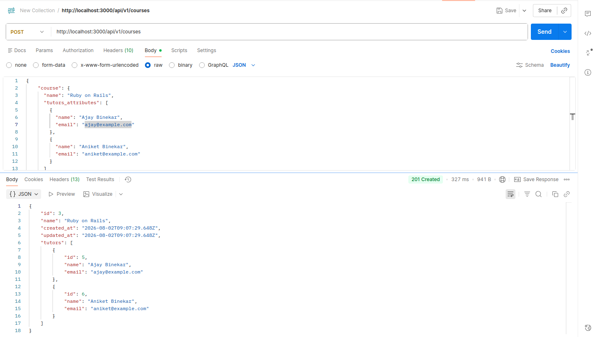
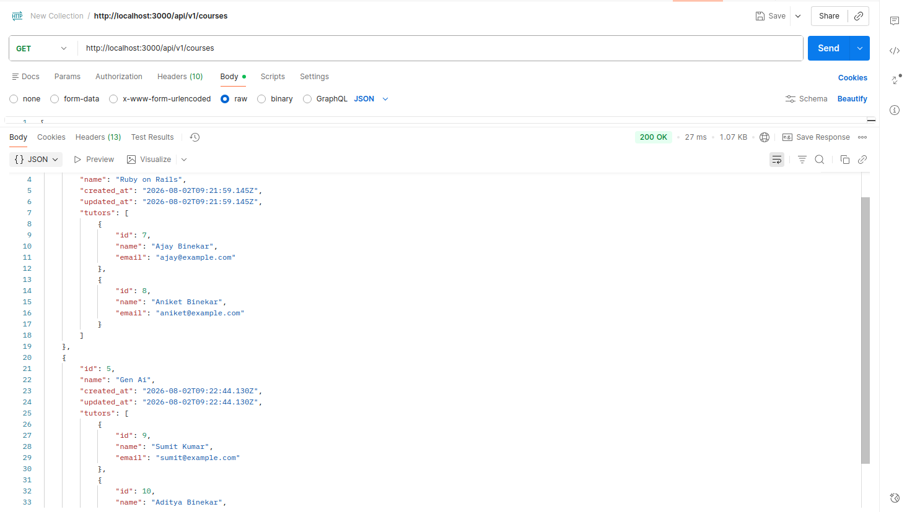

# Course and Tutor API

This is a small Ruby on Rails API built for the Course and Tutor assignment.

The application has two models:

- A course can have many tutors.
- A tutor belongs to one course.

The API lets you create a course along with its tutors in one request, and fetch all courses with their tutors.

## Running the application

The project uses Ruby 3.2.2 and SQLite.

```sh
bundle install
bin/rails db:prepare
bin/rails server
```

The application will be available at `http://localhost:3000`.

## API endpoints

| Method | URL | Purpose |
| --- | --- | --- |
| `POST` | `/api/v1/courses` | Create a course and its tutors |
| `GET` | `/api/v1/courses` | Get all courses with their tutors |

### Create a course with tutors

**Request**

```http
POST /api/v1/courses
Content-Type: application/json
```

```json
{
  "course": {
    "name": "Ruby on Rails",
    "tutors_attributes": [
      {
        "name": "Ajay Binekar",
        "email": "ajay@example.com"
      },
      {
        "name": "Aniket Binekar",
        "email": "aniket@example.com"
      }
    ]
  }
}
```

**cURL**

```sh
curl -X POST http://localhost:3000/api/v1/courses \
  -H "Content-Type: application/json" \
  -d '{
    "course": {
      "name": "Ruby on Rails",
      "tutors_attributes": [
        { "name": "Ajay Binekar", "email": "ajay@example.com" },
        { "name": "Aniket Binekar", "email": "aniket@example.com" }
      ]
    }
  }'
```

The endpoint returns `201 Created` and the saved course with its tutors.

```json
{
  "id": 1,
  "name": "Ruby on Rails",
  "tutors": [
    {
      "id": 1,
      "name": "Ajay Binekar",
      "email": "ajay@example.com"
    }
  ]
}
```

### Get all courses

**Request**

```http
GET /api/v1/courses
```

**cURL**

```sh
curl http://localhost:3000/api/v1/courses
```

The endpoint returns `200 OK` and an array of courses. Each course includes its tutors.

```json
[
  {
    "id": 1,
    "name": "Ruby on Rails",
    "tutors": [
      {
        "id": 1,
        "name": "Ajay Binekar",
        "email": "ajay@example.com"
      }
    ]
  }
]
```

## Validation

- Course name is required.
- Tutor name and email are required.
- Tutor email must be valid and unique.
- Email addresses are stored in lowercase.
- Invalid requests return JSON validation errors with `422 Unprocessable Content`.

## Postman screenshots

### Creating a course and tutors



### Fetching all courses



## Tests

Run the test suite with:

```sh
bundle exec rspec
```

The request specs cover course creation, listing courses, validation failures, duplicate emails, email normalization, and invalid request parameters.

For code style checks:

```sh
bin/rubocop
```
